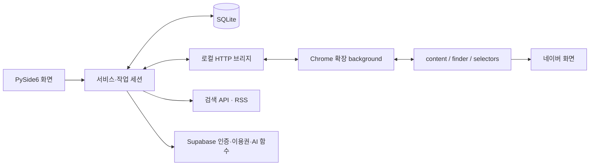

# 이웃부스터 배포본 기술 분석 — 고니

검증일: 2026-10-20. 고니가 작성한 정적 분석 문서다. 이웃부스터의 원저작권이나 서비스 운영권을 이전받았다는 뜻은 아니다.

## 1. 분석 대상과 범위

- 사용자 제공 [Drive 배포본](https://drive.google.com/file/d/1MnH3A8ujocBS0srFw5Di1RQcm1FJHvPp/view).
- 배포 파일: `이웃부스터_v1.0.1.zip`, 50,900,211 bytes.
- ZIP SHA-256: `8dd0b162805d2ad7f3b5264f08afd6d62ffc38f1ee0d0c2e8539c25d80a0a202`.
- 확장 manifest 버전: `1.3.16`. ZIP 이름의 버전과 다르다.
- [Threads 사용방법 링크](https://www.threads.com/@kujilab_/post/DcoR3nwiV38)는 열람하지 못했다. 게시물 내용은 분석 근거로 사용하지 않는다.

| 조사 항목 | 확인 결과 |
|---|---|
| ZIP | 일반 파일 15개, 디렉터리 항목 포함 21개 |
| 확장 웹 자산 | HTML 1, CSS 2, JS 6, JSON 2 |
| Windows 앱 | Python 3.13 + PyInstaller + PySide6 |
| 앱 모듈 | `src.*` 80개 + `app` 진입점 1개 |
| 코드 객체 | 1,890개: 모듈·클래스·함수·lambda·컴프리헨션 포함 |
| 데이터 | SQLite 테이블 13개, 스키마·조회 문자열 확인 |
| JavaScript | 6개 모두 AST 파싱, 파싱 오류 0 |
| REA 정적 그래프 | 노드 14,046 / 관계 13,487 / 미해결 항목 4,166 |
| 실행 검증 | 대상 EXE·확장·서버·네이버 작업 실행 안 함 |

81개 앱 모듈의 전체 심볼·import 목록과 테이블 열 이름은 [기술 색인](neighbor-booster-index.json)에 있다. 코드 객체 수를 사용자 기능 수나 일반 함수 수로 표현하지 않는다.

REA 6.5.0 결과의 `truncated=false`, omitted nodes/relations=0이지만 의미 관계의 coverage는 `unknown`이다. 모든 동적 호출 관계를 해명했다는 의미가 아니다.

Evidence ID:
`ev_7c562a757685fc3c284c769ef5248188ab9e569cd8f5f63e1e47b856e2931f26`

## 2. 전체 구조

화면 자체는 웹앱이 아니다. Windows 본체는 Qt 위젯이고, Chrome 확장 팝업과 페이지 위 작업 패널만 HTML/CSS다.

### 계층별 책임

| 계층 | 주요 모듈 | 읽어낸 책임 |
|---|---|---|
| 시작·공유 상태 | `app`, `src.app_context`, `src.config` | 앱 진입, 서비스 조립, 설정 위치 |
| 데이터 | `src.database.db`, `schema` | 프로필, 대상, 이력, 이웃, 반응자, 문구, 마이그레이션 |
| 모델 | `src.models.entities`, `enums` | 작업/결과/계정/대상 데이터와 상태 |
| 접속 연결 | `bridge_server`, `bridge_controller` | 로컬 연결·페어링·메시지 분배·작업 제어 |
| 작업 상태 | `browser_session`, `neighbor_session`, `interaction_session`, `onestop_service` | 현재 작업, 순서, 중단, 진행률, 결과 집계 |
| 대상 준비 | `target_service`, `target_filter_service`, `url_service`, `dedupe_service` | URL 정규화, 대상 등록, 제외 조건, 중복 검사 |
| 콘텐츠 수집 | `naver_api_service`, `rss_service`, `neighbor_service`, `responder_service` | 검색, 최신 글, 기존 이웃, 내 글 반응자 |
| 문구 | `template_service`, `default_templates`, `phrase_source`, `ai_text_service` | 문맥 값, 조각 결합, 생성 후보, AI 경로 |
| 인증·이용권 | `auth_service`, `license_service`, `ai_quota_service`, `supabase_client`, `device_service` | 로그인, 기능 이용권, 생성 할당량, 기기 관련 처리 |
| 운영 | `backup_service`, `excel_service`, `action_log_service`, `system_service` | 백업, 입출력, 작업 이력, 환경 정보 |
| UI | `src.ui.*`, `src.ui.pages.*` | 홈, 신규 대상, 서이추, 댓글, 이웃, 반응자, 템플릿, 기록, 설정 |

함수 이름에서만 추정한 내용은 구현 세부 확정으로 보지 않는다. 예를 들어 라이선스 클래스의 존재는 서버 검증이 올바르게 강제된다는 증거가 아니다.

## 3. 브라우저 확장

### 파일별 기술

| 파일 | 역할 |
|---|---|
| `manifest.json` | MV3, service worker, 페이지 스크립트, 권한 선언 |
| `background.js` | 로컬 브리지 발견·페어링, 주기 조회, 탭/프레임 선택, 결과 전달 |
| `content.js` | 페이지 상태·본문·계정 읽기, 입력 보조, 패널, 작업 상태 감지 |
| `finder.js` | 후보 요소 찾기, 보이는 요소 판별, 대기·차단 상태 판단 |
| `selectors.js` | 화면 유형별 선택자와 문구 |
| `pagehook.js` | 페이지 MAIN world의 보조 관찰 |
| `popup.html/js/css` | 연결 코드 입력, 연결 상태, 현재 작업, 제어 버튼 |
| `panel.css` | 페이지 위 작업 패널 스타일 |

권한은 `storage`, `tabs`, `alarms`, `scripting`. 호스트는 네이버 블로그 모바일/데스크톱/관리와 `127.0.0.1`.

`pagehook.js`는 document_start·MAIN world, 나머지 페이지 코드 3개는 document_idle·all_frames로 선언돼 있다. iframe 안쪽 화면을 다루려는 구조가 드러난다.

### 페이지 동작의 관찰 근거

- `startTask`, `runNeighbor`, `runComment`: 작업 종류에 따른 분기.
- `fillMessage`, `setNativeValue`: 입력 요소 값을 채우고 페이지 이벤트와 연결.
- `readPostText`, `readCommentAuthors`, `readRecentPosts`: 본문·댓글 작성자·최신 글 읽기.
- `likeState`, `likeSnapshot`, `watchCompletion`: 반응 상태와 완료 징후 판단.
- `inspectAccount`: 기대 계정과 현재 화면 계정 확인에 쓰이는 수집.
- `buildPanel`, `updatePanel`: 페이지 안 패널 생성·상태 갱신.

이 함수 목록은 실제 네이버 UI에서 지금 작동한다는 검증이 아니다. 선택자 변경과 iframe 구성 차이가 주요 미확인 요소다.

## 4. 로컬 브리지 규약

정적 근거: `background.js`, `src.services.bridge_server`, `bridge_controller`.

- loopback HTTP 서버, 기본 포트 8765와 20개 포트 탐색 범위.
- 앱 식별 응답으로 호환 서버인지 확인.
- 6자리 연결 코드로 페어링하고 후속 요청 토큰 사용.
- `X-BlogMate-Token` 헤더, 확장 Origin 제한 및 페어링 Origin 보관 코드가 있다.
- Chrome storage에 연결 정보가 저장된다. 구체적인 인증 값은 이 저장소에 포함하지 않는다.

| 경로 | 역할 |
|---|---|
| `/api/ping`, `/api/pair` | 앱 발견·연결 |
| `/api/poll` | 현재 작업·명령 조회 |
| `/api/status`, `/api/result` | 중간 상태·최종 결과 전달 |
| `/api/message`, `/api/ai_text` | 문구 조회·문맥 기반 생성 요청 |
| `/api/account` | 페이지에서 읽은 계정 보고 |
| `/api/neighbors`, `/api/neighbor_activity` | 이웃 목록·활동 결과 |
| `/api/my_posts`, `/api/responders` | 내 게시글·반응자 결과 |
| `/api/interaction`, `/api/comment_reply`, `/api/like` | 소통 작업 결과 |
| `/api/reaction_probe`, `/api/diagnose` | 반응 확인·진단 |

로컬 서버 핸들러가 있다는 사실만으로 외부 요청의 보안·동시성·토큰 만료가 검증되지는 않는다. 인증이나 이용권 로직을 제거하거나 기존 서비스로 요청을 재전송하지 않았다.

## 5. 작업 상태와 결과 관리

세 종류의 세션이 역할을 나눈다.

1. `BrowserSession`: 신규 대상 서이추·댓글, 현재 대상·문구·완료 기록.
2. `NeighborSession`: 기존 이웃 수집과 활동 확인.
3. `InteractionSession`: 기존 이웃·반응자 방문, 내 글 답글 등 여러 대상의 진행 집계.

`OneStopRunner`가 순서 있는 단계를 묶으며 `StepRecord`에 결과를 누적한다. 단계 상태에는 IDLE/RUNNING/RESTING/DONE/STOPPED 등이 보인다. 작업 결과에는 성공·실패·건너뜀·로그인 필요·제한 등의 별도 값이 있다.

브라우저 작업 데이터에는 작업 ID, 대상 URL/ID, 기대 블로그 ID, 문구, 진행 위치, 결과·감지 방식 필드가 확인된다. 완료 판단은 클릭 이후의 화면 변화나 댓글 출현 등 근거를 이용하는 코드가 있다. 실제 성공률은 측정하지 않았다.

재구현 시 배울 점:

- 계정·프로필·작업 ID를 결과에 함께 보관.
- 제출 시도와 실제 완료를 별도 상태로 표현.
- 중단·건너뜀·불명확한 결과를 성공으로 집계하지 않음.
- 재시도 전에 이전 결과와 대상의 기존 반응을 확인.
- 브라우저 제한이 생기면 상태를 중단으로 보존.

## 6. 데이터 모델

| 테이블 | 목적 |
|---|---|
| `profiles` | 운영 블로그 프로필 |
| `settings`, `meta` | 설정·버전/메타 정보 |
| `account` | 연결된 계정 정보 |
| `targets` | 작업 대상 블로그·게시글 |
| `history` | 행동 종류·결과·시각·문구 이력 |
| `neighbors` | 기존 이웃과 활동 상태 |
| `my_posts` | 내 게시글 |
| `responders` | 내 글에 반응한 블로거와 답방 상태 |
| `reaction_events` | 게시글별 반응 사건 |
| `templates`, `fragments` | 문구 틀과 조각 |
| `phrase_log` | 최근 사용 문구 기록 |

프로필에 따른 설정 키, 작업 대상·이력 분리, 중복 조회, 제외 대상, 휴지통·복구, 과거 생성 문구 정리, 백업·VACUUM 기능이 DB 코드에 있다.

일부 테이블에는 계정/블로그 ID 또는 계정/블로그/게시글/반응 종류 조합의 UNIQUE 제약이 있다. CREATE TABLE 선언의 열 162개와 마이그레이션 상수에서 발견한 열 추가 후보 24개를 JSON 색인에 기록했다. 두 목록은 겹칠 수 있으며 최종 실행 DB의 열 수를 뜻하지 않는다. 동적으로 조립하는 마이그레이션과 실제 운영 DB는 실행하지 않았다.

`DedupeService`는 대상 등록 때와 작업 직전에 중복을 검사한다. `TargetFilterService`는 필터 프리셋·자기 블로그 제외·중복·최근 작업 여부를 다룬다.

## 7. 문구 생성과 AI

### 로컬 문구

`TemplateService`가 대상 정보, 운영 블로그 정보, 카테고리, 제목, 요약, 인상 깊은 부분 등의 문맥을 사용한다. 후보 생성, 최근 사용 문구 조회, 한국어 조사 처리, 공백 정리, 기본 문구 갱신과 사용자 수정 보존 코드가 있다.

예시 문맥 키:
`blog_name`, `category`, `keyword`, `post_title`, `post_summary`, `impressive_point`, `my_blog_name`, `my_nickname`, `my_topic`.

### 서버 AI

확장이 게시글 본문 일부를 읽어 `/api/ai_text`에 전달하고, 데스크톱 `OpenAiTextService`가 `/functions/v1/ai-generate`를 요청하는 경로가 확인된다.

클라이언트 payload에서 확인한 필드:

- `kind`, `feature`
- `post_title`, `post_text`, `their_comment`
- `recent_texts`, `blog_name`, `category`, `my_topic`

응답 처리에는 사용량·한도·잔여량, 오류 사유, 생성 문구, 토큰 집계, 길이 조정 정보가 있다. `MockAiTextService`도 별도로 존재한다.

**서버의 실제 system prompt, 모델명, 추론 설정, 사용량 검증 코드, 데이터 보관 정책은 이 배포본에서 확인되지 않았다.** 클래스 이름에 OpenAI가 들어 있어도 실제 서버 모델을 확정하지 않는다. 내장 문구와 클라이언트 입력 계약까지가 확보 범위다.

## 8. 화면·HTML·CSS

### 확장 팝업

- 폭 300px, 여백 12px, 본문 12px, 제목 13px, 버튼 11px.
- 맑은 고딕/Malgun Gothic/Segoe UI 계열.
- 배경 `#f4f6fa`, 본문 `#20242c`, 강조 `#2f5496` / `#1f3864`.
- 카드 흰색, 테두리 `#d8dee9`, 카드 radius 8px, 입력/버튼 5px.
- 연결 코드·상태·작업 종류·현재 대상·진행·문구 미리보기.
- 페이지 열기, 문구 입력, 다시 찾기, 건너뛰기, 중지, 연결 해제.

### 페이지 위 패널

- 화면 우측/하단 16px, 폭 260px, 최대 32vw.
- radius 10px, opacity 0.97, z-index 2147483000.
- 그림자 `0 6px 20px rgba(31,56,100,0.18)`.
- 헤더·접기·작업 정보·진행·문구·상태·제어 버튼.
- waiting/done/error/unavailable/paused에 따른 상태 표시.

### 본체

주 스타일 QSS 10,259 bytes와 추가 QSS 2개를 로컬에서 확보했다. Qt QSS는 HTML/CSS 웹앱 전체 소스가 아니다. UI 클래스·시그널·위젯 생성은 Python 바이트코드에 있고 원래 `.py`는 배포되지 않았다.

## 9. 설명서와 실제 코드의 차이

| 문서 표현 | 코드에서 확인한 차이 |
|---|---|
| 최종 등록은 사용자가 직접 | `auto_submit` 분기와 `autoSubmit()` 존재 |
| 모든 데이터 로컬, 외부 전송 없음 | Supabase 인증 및 서버 AI 요청 경로 존재 |
| 외부 AI 없이 내장 문구 | Mock/서버 AI 경로가 함께 존재 |
| v1.0.1 | 확장 manifest는 1.3.16 |
| 개발 소스·환경 예시 참고 | 언급한 일부 개발 파일은 ZIP에 없음 |

안내와 코드 차이는 배포 버전이 섞였을 가능성을 보여 주지만 원인을 확정하지는 않는다. 검색 노출이나 방문자 증가를 증명하는 평가 자료도 포함되어 있지 않다.

## 10. 고니에 반영한 결과

- 반복 가능한 ZIP/PyInstaller/PYZ 정적 분석기.
- 원본을 실행하지 않는 합성 아카이브 검증 테스트.
- 81개 모듈의 심볼·import, 13개 테이블 열, 웹 자산 색인.
- 기능·데이터·통신·UI·AI 의존성 분석과 근거.
- 재사용 스킬 및 실행 프롬프트.

배포 원본·추출한 HTML/CSS/JS·QSS·전체 디스어셈블리는 로컬 조사 자료다. 공개 재배포 라이선스를 확인하지 못한 타사 원본과 서버 인증 값은 공개 스킬에 포함하지 않았다.

이 결과는 기술 분석 패키지다. 실제 네이버 품앗이 도구를 새로 완성·배포했거나 차단된 브라우저 작업을 재개한 결과는 아니다.
